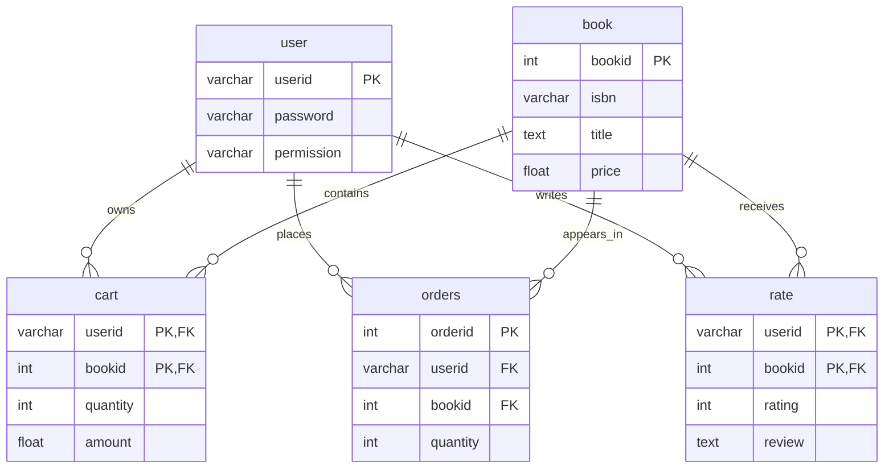

# Online Bookstore — Database Systems Course Project

> **Historical coursework (2021–2022) · PHP + MySQL · Group project**
>
> ⚠️ **For educational review and local development only. Not production-ready or safe to expose to the public internet.** See [security review](docs/SECURITY_REVIEW.md).

A relational-database-driven online bookstore built for a Database Systems group project at Peking University. The prototype connects a PHP website to MySQL and illustrates CRUD operations, relationships between entities, and a basic user-to-order workflow.


## Features demonstrated

| Area | Functionality |
| --- | --- |
| Catalog | Browse books, view details, and search by title, author or publisher |
| Administration | Add, edit and remove books; inspect recorded orders |
| Accounts | Register, log in, and manage a local session |
| Shopping cart | Add books, edit quantities, remove items |
| Orders | Transfer cart items to an order table (demo only; no payment integration) |
| Reviews | Submit/update a book rating and review; view aggregated rating |

These features are **present in the submitted source code**. They have not been end-to-end retested on a running web server for this repository preparation.

## Technology

- **Backend:** PHP, MySQLi
- **Database:** MySQL (original dump: 5.7.31)
- **Frontend:** HTML, CSS, Bootstrap, JavaScript
- **Original local setup:** WAMP / phpMyAdmin (original PHP version: 7.3.21)

## Database relationships

The publicly shared database script retains the **five tables actually found in the SQL dump**: `user`, `book`, `cart`, `orders`, and `rate`.



The report also *proposed* `few_author` and `bA` for many-to-many authorship, but neither table appears in the supplied SQL dump. Accordingly, they are **not claimed as implemented**. Additional notes: [Schema](docs/SCHEMA.md).

## Run locally

**Requirements:** a local PHP environment with MySQLi enabled, MySQL/phpMyAdmin, and a web server such as WAMP. The original environment was PHP 7.3 / MySQL 5.7; compatibility with newer versions has **not** been verified.

1. Create a database named `bookstore` with UTF-8 (`utf8mb4`) support.
2. Import [`database/bookstore.sql`](database/bookstore.sql) through phpMyAdmin or `mysql -u root -p bookstore < database/bookstore.sql`.
3. Place the repository folder under your WAMP `www` directory (for example `wamp64/www/online-bookstore-database`).
4. Configure local database credentials with environment variables `DB_HOST`, `DB_USER`, `DB_PASSWORD`, `DB_NAME` (default localhost / root / blank password / bookstore is intended **only** for isolated WAMP-style development).
5. Open `http://localhost/online-bookstore-database/index.php`.
6. To test member functions, use **SignIn** to create a fresh local account. To test administrator screens in an isolated local DB, promote **your own local test account** using `UPDATE user SET permission='root' WHERE userid='YOUR_TEST_ID';` (`root` here is an application role).

> The public SQL contains fictional example books only; it does **not** include the original user profiles, passwords, orders, carts, reviews, or original commercial book descriptions. Book cover files have been replaced with the existing placeholder image. The report's full source document is not redistributed.

## Screenshots from the original report

| Book management | Cart and orders |
| --- | --- |
|  |  |
|  |  |


These historical screenshots illustrate the original group-project interface and may show the original sample data rather than the anonymized sample data shipped here.

## Repository map

```text
.
├── index.php, item.php, search_result.php   # Catalog and search
├── login.php, signin.php, profile.php        # User flows
├── cart.php, purchase.php, orders.php        # Cart and order flows
├── add.php, edit.php, *.php                  # Administrative and form handlers
├── db_con.php                               # Local DB environment configuration
├── database/bookstore.sql                   # Five-table schema + fictional seed data
├── assets/, css/, js/, image/               # Website resources
└── docs/                                    # Screenshots, schema and security review
```

## Limitations and improvements

The original implementation illustrates database-backed web development rather than a secure e-commerce product. It still has important problems: unsafe SQL construction in multiple handlers, missing authorization checks, lack of CSRF protection, insufficient input/file upload validation, use of `FLOAT` for prices, and no atomic order transaction. The demo checkout intentionally does not collect payment details. **Do not deploy this application publicly.**

See [Security & technical debt](docs/SECURITY_REVIEW.md). Potential next version: refactor CRUD through parameterized statements and authorization middleware; use `DECIMAL` for money; implement transactions, tests and containerized setup.

## Project context and attribution

- **Context:** Database Systems final group project, Peking University, 2021–2022.
- **Team:** 5 students (per submitted report).
- **Individual contribution:** _To be verified and documented before recruiting/public presentation._
- **Source:** Based on the submitted project source, MySQL dump and group report. The report and original sample records are not published here.
- **Public-sharing edits (2026):** anonymized/fictional database seed data, consolidated local connection settings, prepared/hashed registration and login, removal of the mock credit-card form, removal of commercial book-cover assets, and documentation. These are housekeeping/security improvements and are **not claimed as part of the original coursework**.

**Licensing:** This repository includes group-project code and third-party Bootstrap assets. No new open-source license is asserted for the group work. Confirm collaborator permissions before making the repository public.
