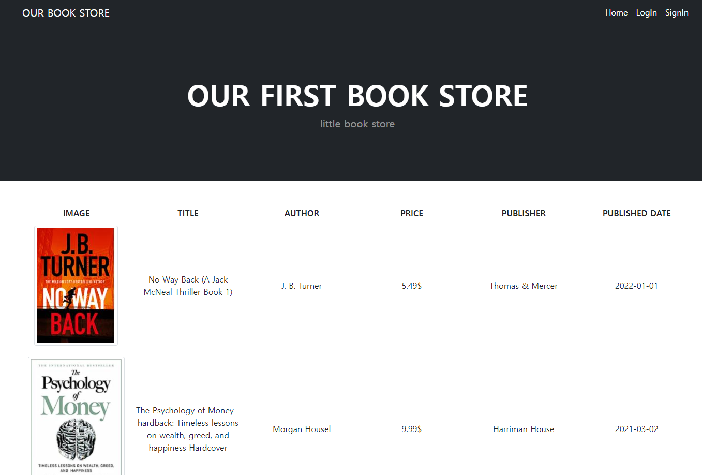
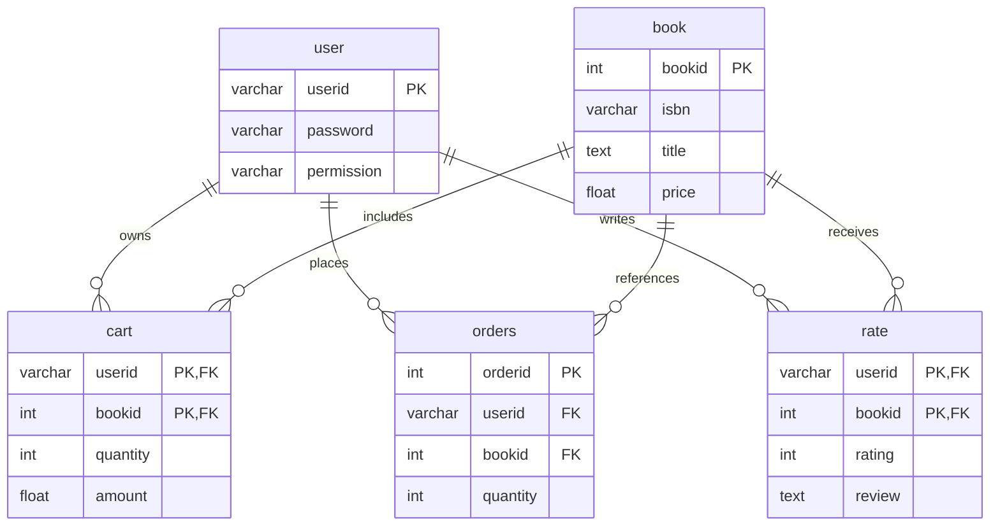
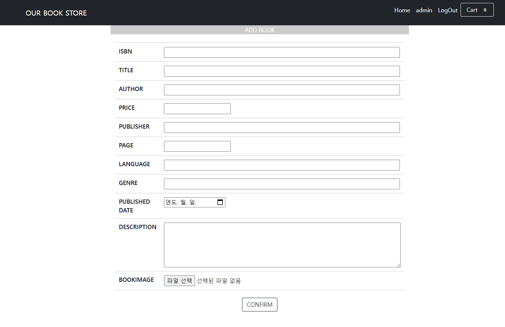
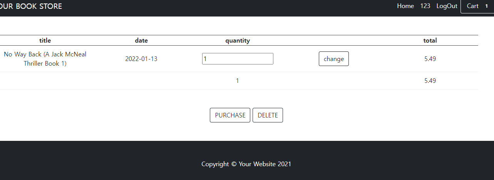
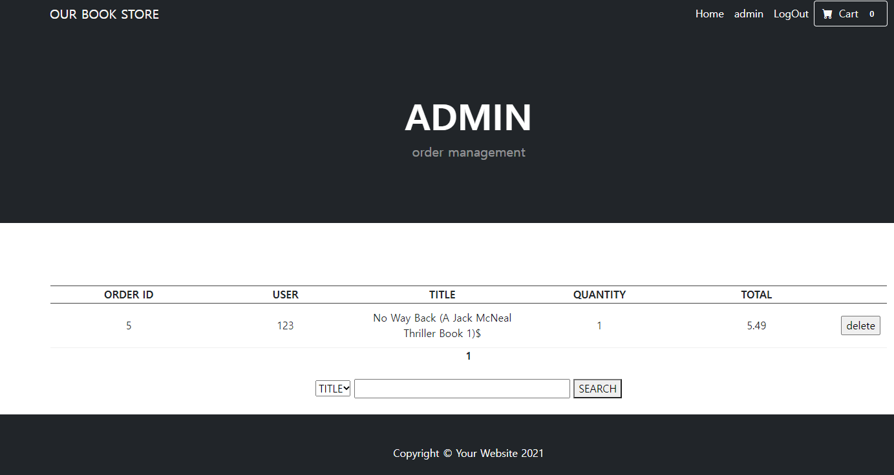
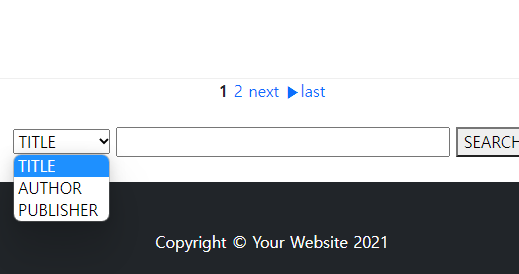

# Online Bookstore — Database Systems Course Project

> Historical coursework (2021–2022) · PHP + MySQL · Five-person team project
>
> **Archival, local-use project.** The original application is not suitable for public deployment. See [Security & maintenance notes](docs/SECURITY_REVIEW.md).

A relational-database-backed online bookstore developed as a Database Systems group project at Peking University. The application connects a PHP website to MySQL to demonstrate entity relationships, SQL-backed CRUD workflows, and a basic bookstore management interface.



## Key features

| Area | Implemented in the submitted project source |
| --- | --- |
| Book catalog | Browse books, inspect book details, and search by title, author, or publisher |
| Administration | Add, edit, and remove books; view stored orders |
| User accounts | Registration, login, and session-based navigation |
| Shopping cart | Add or remove books and change quantities |
| Order records | Create order rows from cart contents (coursework demo, **not** a payment integration) |
| Reviews | Submit book ratings/reviews and view rating information |

These functions are reflected in the original source code and group report. They have **not** been end-to-end retested in a running web server as part of this archive preparation.

## Technology stack

- **Database:** MySQL (original database dump: MySQL 5.7.31)
- **Backend:** PHP (original environment: PHP 7.3.21), MySQLi
- **Frontend:** HTML, CSS, Bootstrap, JavaScript
- **Original development setup:** WAMP and phpMyAdmin

## Database design

The supplied SQL dump defines five tables: `user`, `book`, `cart`, `orders`, and `rate`. Foreign keys connect carts, orders, and reviews to the relevant user and book records.



The report discussed optional multi-author tables (`few_author` and `bA`), but these are not present in the supplied SQL dump and are not counted as implemented. See [schema notes](docs/SCHEMA.md).

## My contributions

This was a five-person team project. My work focused on database implementation and collecting book metadata:

- **Database schema & relationships (team collaboration):** Collaborated on the design of the `user`, `book`, `cart`, `orders`, and `rate` tables and their primary/foreign-key relationships.
- **SQL development:** Wrote SQL for database tables and data retrieval/manipulation supporting the bookstore workflows.
- **Book data collection:** Collected and organized book catalog data from online sources for the project.

## Screenshots from the original report

| Add/edit books | Shopping cart |
| --- | --- |
|  |  |

| Admin orders | Ratings and reviews |
| --- | --- |
|  |  |



## Run locally (historical setup)

**Local-only:** Use a private, isolated development environment; do not expose the web server to the public internet. The original code contains insecure authentication and database access patterns.

1. Install a local PHP/MySQL stack with MySQLi support, such as WAMP. The coursework was originally developed using PHP 7.3 / MySQL 5.7; modern versions have not been validated.
2. Create a local MySQL database named `bookstore` and import [`database/bookstore.sql`](database/bookstore.sql) using phpMyAdmin.
3. Place the repository directory under your local WAMP `www` directory.
4. The original [`db_con.php`](db_con.php) and several other PHP files use `localhost`, the MySQL `root` account, and an empty database password. These are **historical local development values**, not settings for a real server. Adjust the database configuration **only in your local copy**, and do not commit actual database passwords.
5. Open `http://localhost/online-bookstore-database/index.php` (adjust the URL if you use another directory name).
6. The original SQL includes **fictional classroom test accounts**, with passwords stored in plaintext; use them only in an isolated test setup. Never use actual personal credentials or payment-card information.

**Dataset fidelity:** This repository now retains the originally submitted SQL dump, its 15 collected book records, five fictional test account rows, original sample cart/review records, and original `image/` assets. It is intentionally a historical snapshot rather than a modernized production application. Some original catalog descriptions, cover images, and metadata may carry third-party rights; review permissions before redistributing them in a public repository.

## Repository structure

```text
.
├── index.php, item.php, search_result.php  # Browse and search books
├── login.php, signin.php, profile.php       # User-facing account pages
├── cart.php, purchase.php, order.php        # Cart, order form and handler
├── add.php, edit.php, *.php                 # Book and administrative functions
├── db_con.php                               # Original local database connection
├── database/bookstore.sql                   # Unmodified original SQL dump and test records
├── image/                                    # Original project assets and book covers
├── assets/, css/, js/                        # Website assets
└── docs/                                     # Project screenshots and technical notes
```

## Limitations and project context

The original coursework uses plaintext test passwords, hard-coded local DB settings, dynamically built SQL queries, and payment-card-like form fields with no payment service integration. It also lacks comprehensive authorization checks, transaction handling, and production security controls. **Do not deploy this source to a public server or enter real credit card details.** See [Security & maintenance notes](docs/SECURITY_REVIEW.md).

- **Course:** Database Systems, Peking University, 2021–2022
- **Team:** Five students
- **Source:** Original submitted PHP source, MySQL dump, and historical course-report screenshots
- **Repository preparation (2026):** Documentation and GitHub organization only. Original project PHP, SQL records, and images were restored without claiming later improvements as student coursework.

**Licensing:** This includes group-project code and third-party website assets / commercial book content. No blanket open-source license is asserted. Please confirm collaborator permission and applicable content rights before public redistribution.
